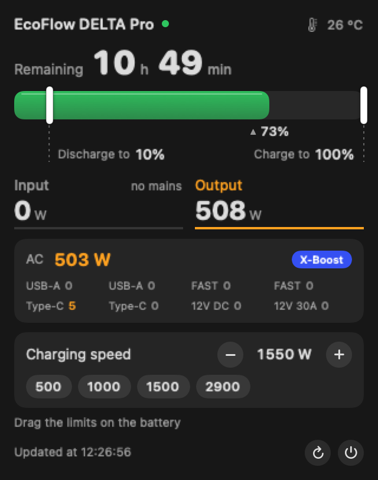
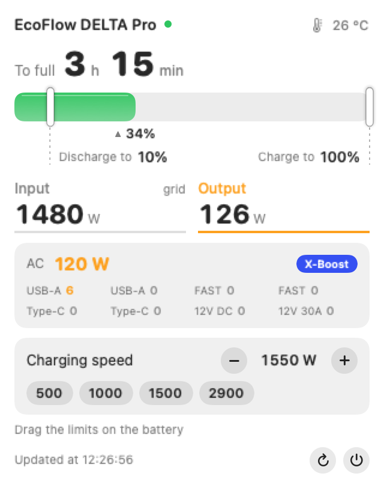
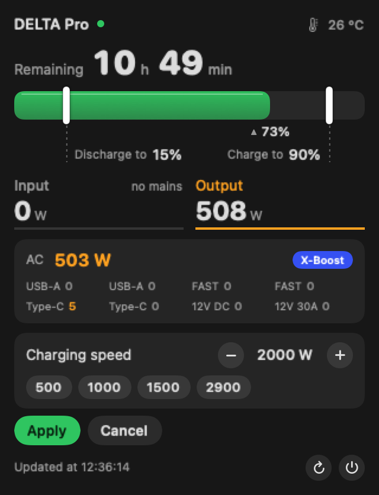
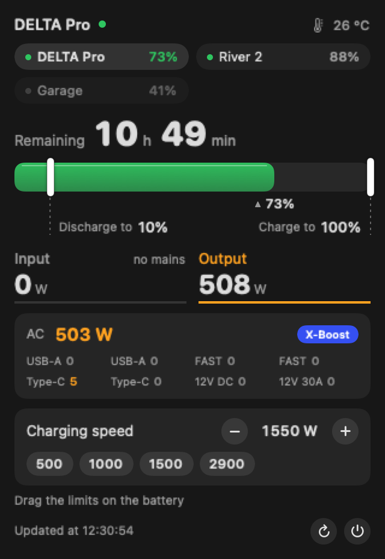

# EcoFlow DELTA Pro for the macOS menu bar

[Українською](README.uk.md)

A small native menu bar app for the **first-generation EcoFlow DELTA Pro**: battery level as a ring in the menu bar, and a compact panel with time remaining, input/output power, port loads, and **limit handles you drag right on the battery**.


| Blackout | Charging | Editing limits |
|---|---|---|
|  |  |  |



*(Screenshots are rendered from sample data with `--cards`.)*

## What it does

- **Menu bar:** a white template ring (adapts to light/dark menu bars like the system icons) with the charge % in the middle; a bolt appears while external power is flowing in; dimmed when data is older than 5 minutes. About 37 pt wide.
- **Panel (click):** time remaining (or time to full), a charge bar with markers, input / output watts, AC load with the X-Boost badge, USB-A / FAST / Type-C / 12 V ports.
- **Limits by dragging:** drag the *Discharge to* (0 to 30%) and *Charge to* (50 to 100%) handles on the bar, smoothly in 1% steps. Changes are only proposed (orange) until you press **Apply**.
- **Charging speed:** AC charging power, 200 to 2900 W.
- **Honest writes:** EcoFlow answers `code=0 Success` to *any* command, even nonsense, so after every write the app reads the value back (up to 20 s) and tells you whether the station confirmed it.
- **Input means external input:** input = AC inlet + DC inlet. EcoFlow's own app shows `pd.wattsInSum`, which also counts energy moving between the main and the extra battery, so it can show hundreds of watts during a blackout. This app shows 0 W when nothing is plugged in.
- **Several EcoFlow devices:** every device bound to your account is discovered automatically (no serial numbers to list). The panel gets a switcher with each device's charge; right-click the icon to pin any of them to the menu bar (one ring per pinned device). Up to 8 devices, one request per device per minute. Only the DELTA Pro has controls; other models get a **read-only** panel (best-effort field mapping, **untested on their hardware**; the input/output numbers there come from the station's totals, which on some models include internal transfers).
- Right-click the icon for *Refresh* / pinning / *Quit*. English and Ukrainian UI (follows the system language).
- Lightweight: ~0% CPU idle, ~30 to 40 MB RAM, one HTTPS request per minute.

## Requirements

- macOS 14+, Xcode Command Line Tools (`xcode-select --install`)
- An EcoFlow **developer** account with an Access Key and Secret Key ([developer.ecoflow.com](https://developer.ecoflow.com)); your DELTA Pro bound to the same account

## Install

```sh
git clone https://github.com/RaftTone/ecoflow-delta-pro-menubar.git
cd ecoflow-delta-pro-menubar
./build.sh           # builds ~/Applications/EcoFlowBar.app and starts it at login
```

Store your keys in the macOS Keychain (nothing is kept in files or in the code):

```sh
security add-generic-password -U -s ua.rafttone.ecoflowbar -a ecoflow -w \
  '{"access_key":"YOUR_ACCESS_KEY","secret_key":"YOUR_SECRET_KEY","sn":"OPTIONAL_DEFAULT_SN","region":"eu"}'
```

`sn` is optional (a fallback if the device list cannot be fetched). `region` is `eu` (api-e.ecoflow.com) or `us` (api-a.ecoflow.com). Check it works without the UI: `build/EcoFlowBar --once`.

Uninstall: `launchctl bootout gui/$(id -u)/ua.rafttone.ecoflow-bar; rm -rf ~/Applications/EcoFlowBar.app ~/Library/LaunchAgents/ua.rafttone.ecoflow-bar.plist`, then delete the Keychain item.

## Notes and limits

- **Tested only on the first-generation DELTA Pro.** It uses the *legacy* command set (`cmdSet 32`), which differs from DELTA 2 / Pro Ultra. Other models will read fine if the field names match, but writes will not work.
- Only the *charging speed* command (`id 69`) has been confirmed on hardware so far. The *charge limit* (`id 49`) and *discharge limit* (`id 51`) commands follow the same legacy format (and match third-party integrations) but are **not yet confirmed here**; after every write the app reads the value back and tells you honestly if the station ignored it.
- Charge % is `ems.f32LcdShowSoc`, the same number as on the station's display, not a single battery's `bmsMaster.soc` (the two batteries differ by a percent or two).
- Remaining-time estimates from the station are discarded when implausible (e.g. hundreds of hours while on mains).
- Use at your own risk: this writes settings to a device that may power things you care about. Lowering the discharge limit shortens blackout autonomy.
- Unofficial. Not affiliated with or endorsed by EcoFlow. EcoFlow and DELTA are trademarks of their owners.

## Development

Plain AppKit + SwiftUI, no dependencies. `build.sh` compiles `*.swift` with `swiftc`. Handy flags: `--once` (print the state), `--render <dir>` (menu bar icon preview), `--cards <dir>` (panel PNGs, dark/light), `--open-popup` (open the panel programmatically for screenshots). Set `ECOFLOWBAR_LANG=uk|en` to force a language. Code comments are mostly in Ukrainian.

## Related projects

- [matguig/ecoflowbar](https://github.com/matguig/ecoflowbar): menu bar app over Bluetooth LE, built for River 3 Plus, with shutdown protection.
- [bereto-dev/efstatus](https://github.com/bereto-dev/efstatus): menu bar status for DELTA 2 / 3 over MQTT/REST.
- [tolwi/hassio-ecoflow-cloud](https://github.com/tolwi/hassio-ecoflow-cloud): Home Assistant integration, a good reference for command formats.

## License

MIT, see [LICENSE](LICENSE).
