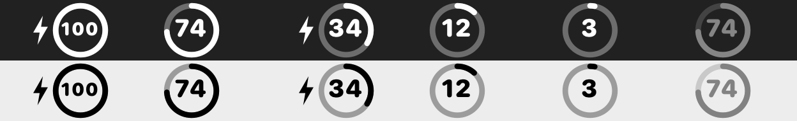
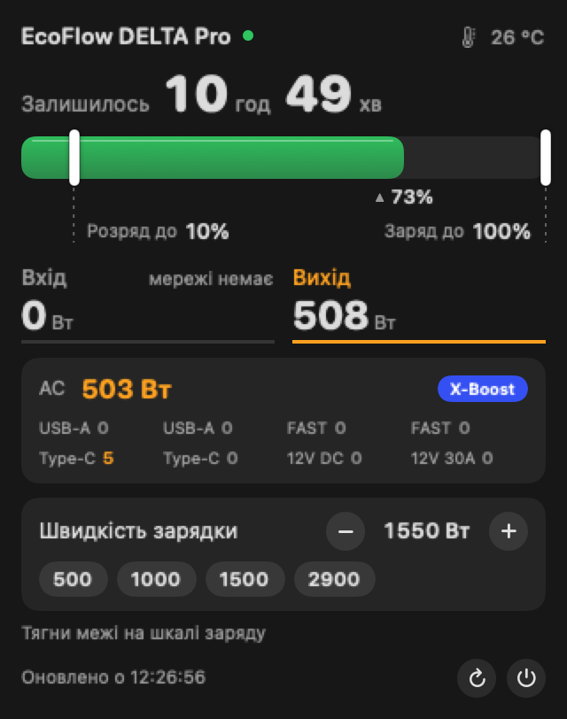

# EcoFlow DELTA Pro у менюбарі macOS

[English](README.md)

Невеликий нативний застосунок для менюбару **EcoFlow DELTA Pro першого покоління**: заряд кільцем у менюбарі й компактна панель із запасом часу, вхідною та вихідною потужністю, навантаженням портів і **межами, які тягнуться прямо по батареї**.





## Що вміє

- **Менюбар:** біле шаблонне кільце (як системні іконки, підлаштовується під світлий/темний менюбар) із відсотком усередині; блискавка, поки йде зовнішнє живлення; притемнення, якщо даним понад 5 хв.
- **Панель (клік):** запас часу (або час до повної), шкала заряду, вхід/вихід у Вт, навантаження AC з X-Boost, порти USB-A / FAST / Type-C / 12 V.
- **Межі перетягуванням:** «Розряд до» (0 до 30%) і «Заряд до» (50 до 100%), крок 1%. Зміни лише пропонуються, доки не натиснеш **Застосувати** (поки є незастосовані зміни, з'являються кнопки «Застосувати» / «Скасувати»).
- **Швидкість зарядки** від мережі: 200 до 2900 Вт.
- **Чесний запис:** EcoFlow відповідає `code=0 Success` на будь-яку команду, навіть неіснуючу, тож після запису застосунок зчитує значення назад (до 20 с) і каже, чи станція підтвердила.
- **«Вхід» = лише зовнішній:** мережа + DC-вхід. Застосунок EcoFlow показує `pd.wattsInSum`, куди входить і перелив між батареями, тому під час блекауту там можуть бути сотні ват. Тут без живлення буде 0 Вт.
- **Кілька пристроїв EcoFlow:** усі пристрої акаунта знаходяться самі (серійники вказувати не треба). У панелі з'являється перемикач із зарядом кожного, правий клік по іконці дозволяє закріпити будь-який у менюбарі (по кільцю на закріплений). До 8 пристроїв, один запит на пристрій на хвилину. Керування лише для DELTA Pro, решта моделей отримують панель **лише для читання** (найкраща спроба зіставити поля, **на їхньому залізі не перевірено**).
- Правий клік: «Оновити» / закріплення / «Вийти». Інтерфейс англійською та українською (за мовою системи).

## Вимоги й встановлення

macOS 14+, Xcode Command Line Tools, обліковий запис **розробника** EcoFlow (Access Key і Secret Key на [developer.ecoflow.com](https://developer.ecoflow.com)), серійний номер станції.

```sh
git clone https://github.com/RaftTone/ecoflow-delta-pro-menubar.git
cd ecoflow-delta-pro-menubar
./build.sh
security add-generic-password -U -s ua.rafttone.ecoflowbar -a ecoflow -w \
  '{"access_key":"КЛЮЧ","secret_key":"СЕКРЕТ","sn":"НЕОБОВ_ЯЗКОВО","region":"eu"}'
```

Ключі лежать лише в Keychain. Перевірка без UI: `build/EcoFlowBar --once`.

## Обмеження

Перевірено лише на DELTA Pro першого покоління (legacy-команди `cmdSet 32`). На залізі поки підтверджено лише команду швидкості зарядки (`id 69`). Команди верхньої (`id 49`) і нижньої (`id 51`) меж того самого legacy-формату (збігаються зі сторонніми інтеграціями), але ще не підтверджені: після кожного запису застосунок зчитує значення назад і чесно скаже, якщо станція її проігнорувала. Користуйся на свій ризик: це змінює налаштування пристрою, який може живити важливе. Неофіційний проєкт, не пов'язаний з EcoFlow.

Ліцензія: MIT.
